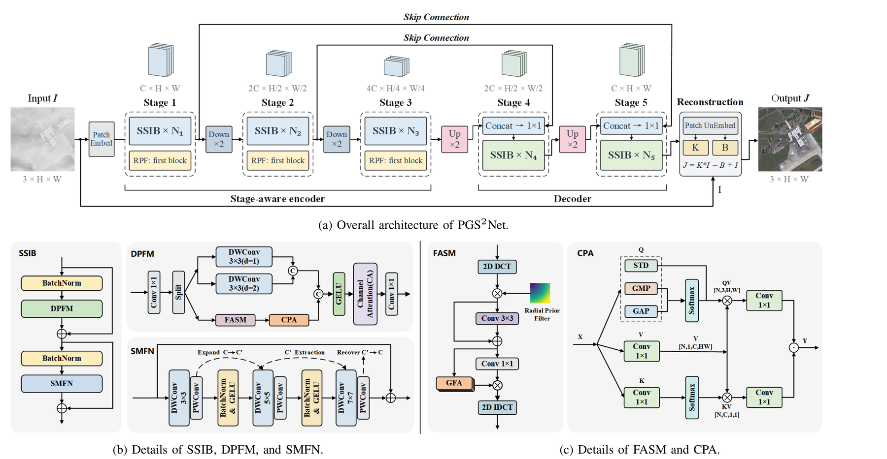
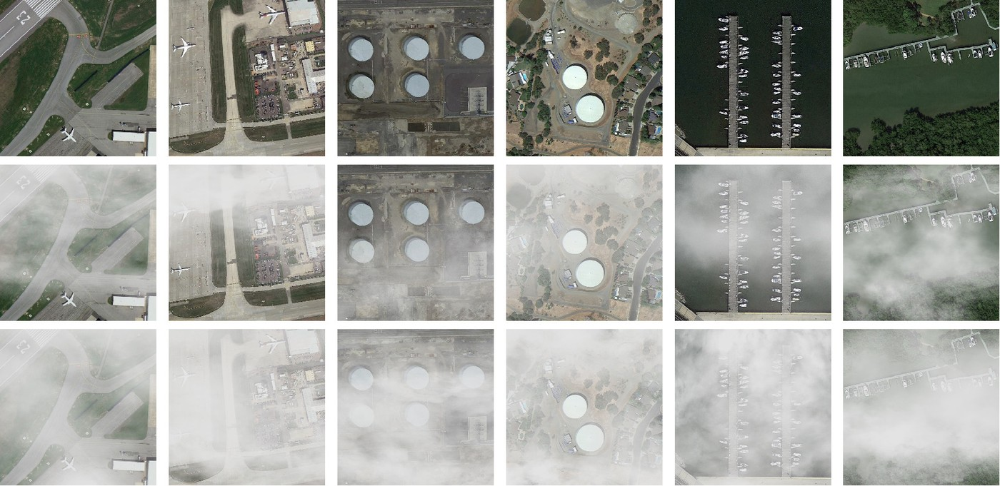

# PGS²Net

Code implementation of the **[A Physics-Guided Stage-Aware Frequency Spectral Network for Remote Sensing Image Dehazing](https://doi.org/10.1109/TGRS.2026.3755826)**

## Method

<div align="center">

</div>

**Pipeline.** A 5-stage encoder–decoder. The encoder stacks Spectral–Spatial Interaction Blocks (SSIB) with the radial prior filter enabled in the first block of each stage; the decoder mirrors it with the prior disabled, and the reconstruction head predicts two residual maps `K` and `B`, so that `J = K ⊙ I − B + I`.

## Repository structure

```text
PGS2Net/
├── models/
│   ├── pgs2net/          # PGS²Net: FASM/RPF, CPA, DPFM, SMFN, small & base variants
│   ├── baseline/         # 40+ retrained baselines (2016–2026), one folder each
│   ├── prior/            # classical priors: DCP, CAP, IHDCP
│   └── networks.py       # MODEL_CLASSES registry + get_dehaze_networks()
├── utils/
│   ├── dataset.py        # paired GT/hazy dataset for training and testing
│   ├── losses.py         # L1 + FFT amplitude/phase criterion (dehaze_criterion)
│   ├── metric.py         # PSNR / SSIM / LPIPS wrappers
│   ├── inference_utils.py # sliding-window inference, image I/O
│   ├── scheduler.py      # gradual warm-up + cosine annealing
│   └── trainer_utils.py  # one training / validation epoch
├── script/
│   ├── cloud_fusion.py   # RSHD-style cloud & haze synthesis
│   ├── detail_zoom.py    # zoom-in crops for qualitative figures
│   ├── image_batch_renamer.py  # optional PyQt5 batch renaming tool
│   └── copy_or_move_file.py
├── data/                 # datasets (download below, not versioned)
├── model_weights/        # checkpoints per benchmark (PGS²Net + all baselines)
├── train.py              # training entry point
├── test.py               # paired evaluation (PSNR/SSIM/LPIPS)
├── predict.py            # inference on a folder of hazy images
└── requirements.txt
```

## Prerequisites

Python 3.10 is recommended. Install PyTorch **before** the remaining packages (`pyzjr` builds on top of it):

```bash
git clone https://github.com/Auorui/PGS2Net.git
cd PGS2Net

conda create -n pgs2net python=3.10 -y
conda activate pgs2net

# 1) install PyTorch first (pick the build for your CUDA driver:
#    https://pytorch.org/get-started/locally/)
pip install torch torchvision

# 2) install the rest
pip install -r requirements.txt
```

## Dataset

**RSHD** (Remote Sensing Heterogeneous-cloud Dataset) is built from 1,050 haze-free backgrounds of DIOR and LEVIR (three scene categories: aircraft, ship, oil tank). Cloud and haze textures are real semi-transparent RGBA patterns, randomly cropped/resized to 512×512, color-corrected, and alpha-composited in 1–3 layers with a random transparency gain, which yields structured and spatially non-uniform degradation instead of a uniform atmospheric model. Thin and thick subsets are split by haze density, each with 840 training and 210 test pairs.

<div align="center">

</div>

*Top row: clear backgrounds. Middle: thin haze (1–2 layers). Bottom: thick, strongly non-uniform haze (2–3 layers).*

- **RSHD download**: [Baidu Netdisk](https://pan.baidu.com/s/1mfpsgL1lf3EOOmN0ymlVfA?pwd=j3yb) (code `j3yb`)
- **Hazy-LEVIR-CD downstream evaluation data**: [Baidu Netdisk](https://pan.baidu.com/s/1BN7uLtRpbOaA103EWpHBPA?pwd=mjj3) (code `mjj3`)

Expected layout — files in `GT/` and `hazy/` are paired by **identical file names**:

```text
data/
├── RSHD/
│   ├── thin/{train,test}/{GT,hazy}
│   ├── thick/{train,test}/{GT,hazy}
│   └── label/                  # Scene Target Detection Annotation File (JSON)
```

The directory `data/cloud_512/` already contains partial semi-transparent RGBA cloud/fog textures for synthesis. To regenerate haze with the paper's pipeline:

```bash
python ./script/cloud_fusion.py
```

## Model Training
To train a model from scratch, use
```bash
# small variant on RSHD-thick
python train.py --model PGS2Net_s --dataset_path ./data/RSHD/thick --epochs 500 --batch_size 8

# base variant
python train.py --model PGS2Net_b --dataset_path ./data/RSHD/thick --epochs 500 --batch_size 8
```
The names of supported models are detailed in MODEL_CLASSES within ./models/networks.py

| Argument | Default | Description |
|---|---|---|
| `--model` | `PGS2Net_s` | key in `MODEL_CLASSES` (`models/networks.py`) |
| `--dataset_path` | local path | folder containing `train/` and `test/` |
| `--epochs` | `500` | total epochs |
| `--batch_size` | `8` | lower it if you hit GPU memory limits |
| `--input_shape` | `[256, 256]` | random-crop size during training |
| `--lr` | `2e-4` | initial learning rate, cosine-decayed to `2e-6` after 3 warm-up epochs |
| `--optimizer` | `adamw` | `adam`, `adamw`, or `sgd` |
| `--amp` | `False` | mixed-precision training |
| `--resume_training` | `None` | checkpoint to resume from |
| `--log_dir` | `./logs` | logs, loss curves, and checkpoints (`logs/<model>/`) |

Training is single-GPU (`CUDA_VISIBLE_DEVICES='0'` is set at the top of `train.py`). Checkpoints are saved by validation PSNR, plus a periodic snapshot every 200 epochs. To train on another benchmark, only change `--dataset_path` and `--model`.

## Model Evaluation

```bash
python test.py \
  --model PGS2Net_s \
  --data_dir ./data/RSHD/thick/test \
  --weight ./model_weights/RSHD/thick/PGS2Net_s.pth \
  --window_size 256 --stride 128
```

- `--data_dir` must contain `GT/` and `hazy/` with matching file names.
- Per-image and averaged PSNR / SSIM / LPIPS are printed.
- Images larger than `window_size` are restored with a sliding window (reflect padding + Hann-window blending) to avoid boundary seams, so metrics are reported at native resolution.
- By default only metrics are computed. To also dump restored images, pass `--only_index ""` (the flag is parsed with `type=bool`, so `--only_index False` is still truthy), or use `predict.py` below.

## Inference on your own images

```bash
python predict.py \
  --model PGS2Net_b \
  --weight ./model_weights/RSHD/thick/PGS2Net_b.pth \
  --input_dir /path/to/hazy_images \
  --result_dir ./results
```

Results are written to `results/<model>/<timestamp>/img/`. No ground truth is required, so this is also the entry point for feeding dehazed images into a detector, segmenter, or change-detection model.


## Citation
If you find our work useful in your research, please consider citing:

```bibtex
@ARTICLE{11806865,
  author={Zeng, Junrui and Chen, Bo and Zhang, Hua and Zhou, Huaifang and Miao, Hongrui},
  journal={IEEE Transactions on Geoscience and Remote Sensing}, 
  title={A Physics-Guided Stage-Aware Frequency Spectral Network for Remote Sensing Image Dehazing}, 
  year={2026},
  volume={},
  number={},
  pages={1-1},
  keywords={Remote sensing image dehazing;Frequency spectral modeling;Physics-guided learning;Stage-aware network},
  doi={10.1109/TGRS.2026.3755826}}
```

## Acknowledgements

This work was supported by the Key Research and Development Program of Heilongjiang Province under Project No. 2024ZXJ07B05. We thank the authors of DIOR, LEVIR-CD, RSID, RRSHID, RHDRS, SateHaze1K and CUHK-CR2 for making their data publicly available, and the authors of all compared methods for their open-source implementations. The training utilities rely on [pyzjr](https://pypi.org/project/pyzjr/).


## Contact

For questions about the code or the RSHD dataset:

- **Junrui Zeng** — 2165648225@qq.com (Gmail: zjricetea@gmail.com, may reply slowly)
- **Bo Chen** (corresponding author) — cba04570@btch.edu.cn

If this repository helps your research, a ⭐ is appreciated.
